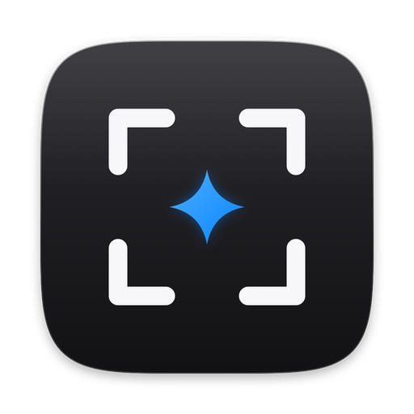

<p align="center">
  
</p>

<h1 align="center">Clear Screenshot</h1>

<p align="center">
  A macOS app that finds every screenshot on your Mac and in your Photos library,<br>
  understands what is in them, and helps you organize and clean them up — all on-device.
</p>

---

## Highlights

- **Finds everything** — screenshots in any folder (Spotlight), folders of third-party capture apps
  (CleanShot, Shottr, oh-my-opensnap, …), and the Photos library (iPhone/iPad screenshots synced via iCloud).
- **Understands them, privately** — on-device text recognition (Korean/English), barcode/QR detection,
  Apple's Vision image classification and, on macOS 27+, Apple's on-device foundation model to
  describe each picture. Nothing ever leaves your Mac.
- **Smart categories** — *Safe to Delete* (verification codes, delivery tracking, payment
  confirmations, coupons/barcodes, QR codes, directions) and *Personal Info* (card numbers,
  resident IDs, bank accounts, passwords, phone numbers, emails, addresses).
- **Search like Spotlight** (`⌘F`) — by text in the image, by what the picture shows
  ("coffee", "drinks", "dog"), by app ("Instagram", "browser") or device, in four languages.
- **Similar screenshots** — grouped with Vision feature prints plus capture time;
  **Quick Tidy** (`R`) keeps the best shot of each group and removes the rest.
- **Organize** — move files (and export Photos items) into dated folders (`2026-05`, `2026/05`, `2026`).
- **Knows the source** — iPhone / iPad / Mac / Apple Watch (by exact screen resolution) and the
  app the screenshot was taken in.
- **Fix it yourself** — remove or add categories per screenshot; *Keep* screenshots so they are never suggested for cleanup.
- **Native feel** — Liquid Glass sidebar (macOS 26+), menu-bar icon, live updates when new
  screenshots appear, light/dark theme, English / 한국어 / 日本語 / Español.

## Requirements

| Feature | macOS |
| --- | --- |
| App | 11 Big Sur or later (Apple silicon) |
| Liquid Glass sidebar | 26 or later (falls back to CSS glass) |
| On-device picture understanding | 27 or later with Apple Intelligence enabled |

## Install

1. Download the latest `.dmg` from [Releases](../../releases).
2. Open it and drag **Clear Screenshot** to **Applications**.
3. The app is not notarized yet, so macOS blocks the first launch. Either right-click the app →
   **Open**, or run:
   ```bash
   xattr -dr com.apple.quarantine "/Applications/Clear Screenshot.app"
   ```
4. Allow **Photos** access when asked (and Desktop access if a capture app saves there).

## Keyboard shortcuts

| Key | Action |
| --- | --- |
| `⌘F` / `⌘K` | Search |
| `R` | Quick Tidy (keep one per similar group) |
| `←` `→` `↑` `↓` | Move between screenshots (`⇧` to extend selection) |
| `Space` / `Enter` | Select / view large |
| `K` · `C` | Keep · Compare selected |
| `⌫` | Move to Trash |
| `⌘A` · `Esc` | Select all · Clear selection / filters |
| `⌘,` | Settings |

## Privacy

All analysis runs locally: text recognition, barcode detection and image classification use
Apple's Vision framework, picture descriptions use Apple's on-device foundation model through a
small bundled Swift helper. Caches live in `~/Library/Caches/clear-screenshot`, settings and
manual corrections in `~/Library/Application Support/clear-screenshot`. Deleting moves files to
the Trash, and Photos items to *Recently Deleted*.

## Build from source

Prerequisites: Xcode (command line tools + Swift), [Rust](https://rustup.rs), and the Tauri CLI.

```bash
cargo install tauri-cli --version "^2" --locked
cd src-tauri
cargo tauri build --bundles app      # → target/release/bundle/macos/Clear Screenshot.app
cargo tauri build --bundles dmg      # → target/release/bundle/dmg/*.dmg
cargo test                           # unit tests (classification rules, layouts, …)
```

`build.rs` compiles the Swift helper (`src-tauri/helper/describe.swift`) automatically; without a
macOS 27 SDK it ships a stub and the app falls back to Vision classification.

## Project layout

```
ui/                    Web UI (plain HTML/CSS/JS, no build step)
  main.js              App logic: views, search, quick tidy, settings …
  i18n.js              Translations (ko / en / ja / es)
  objects.js           Picture-category dictionary for search
  apps.js              App detection rules (Instagram, YouTube, browser …)
src-tauri/             Rust backend (Tauri 2)
  src/scan.rs          Finding screenshots (Spotlight, folders, capture apps)
  src/photos.rs        Photos library via PhotoKit
  src/vision.rs        OCR, barcodes, image classification, feature prints
  src/ai.rs            Bridge to the on-device model helper
  src/classify.rs      Safe-to-delete / personal-info rules
  src/device.rs        Device detection by screen resolution
  src/ops.rs           Thumbnails, similarity, trash, organize, caches
  src/glass.rs         Native Liquid Glass sidebar
  src/tray.rs          Menu-bar icon and menu
  helper/describe.swift  Foundation Models helper
scripts/release.sh     Version bump → DMG → tag → GitHub release
```

## Versioning & releases

The project follows [Semantic Versioning](https://semver.org). Changes are recorded in
[CHANGELOG.md](CHANGELOG.md). To publish a release:

```bash
scripts/release.sh 0.2.0
```

This updates the version in `Cargo.toml` and `tauri.conf.json`, builds the DMG, commits, tags
`v0.2.0`, pushes, and creates a GitHub release with the DMG attached, using the matching
CHANGELOG section as release notes.

## License

Private project — all rights reserved.
